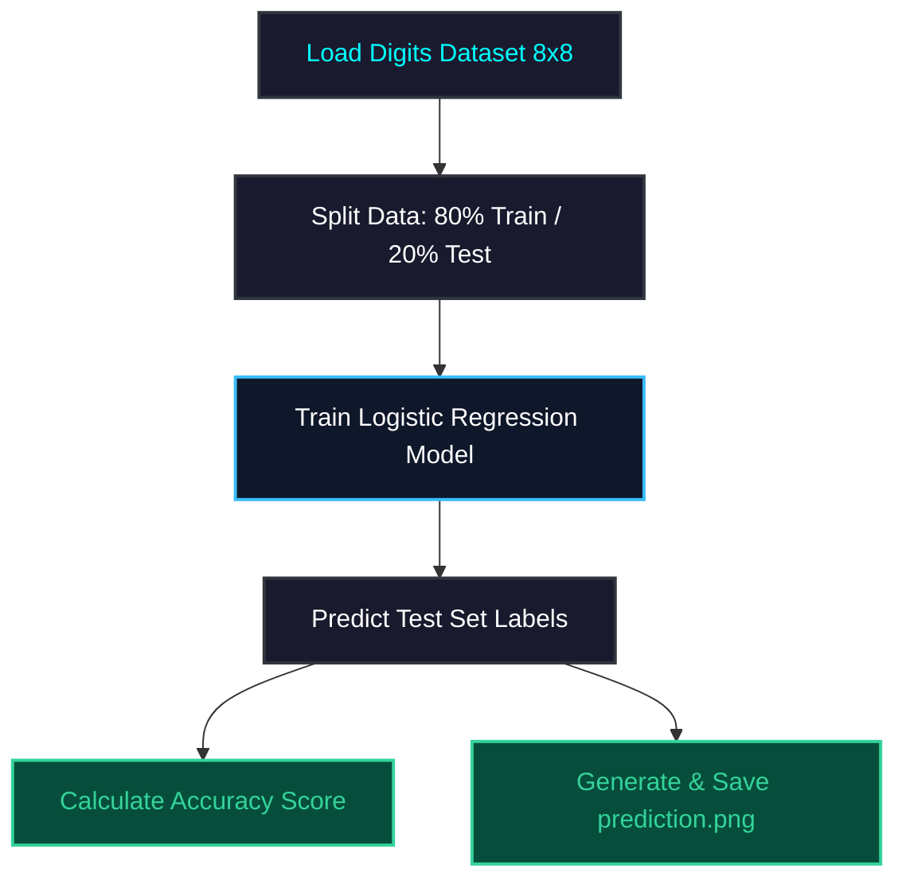

# 🌌 OptiDigit-ML

[](https://www.python.org/)
[](https://www.docker.com/)
[](https://opensource.org/licenses/MIT)
[](https://scikit-learn.org/)

An optimized, containerized machine learning pipeline for handwritten digit classification. Built with **Scikit-Learn** using a tuned **Logistic Regression** model, this repository provides a reproducible, lightweight environment for training, testing, and visualizing model predictions.

---

## ⚡ Features

- 🎯 **High Accuracy**: Logistic Regression classifier tuned for the 8x8 MNIST-equivalent digits dataset.
- 🐳 **Dockerized Setup**: Zero-dependency environment replication with Docker.
- 📊 **Visual Output**: Auto-saves visualization of the actual vs. predicted label to `prediction.png`.
- 🛠️ **Developer Friendly**: Structured with `.gitignore`, pinned `requirements.txt`, and standard licensing.

---

## 📐 Project Architecture



---

## 🚀 Quick Start

You can run this project either locally using a Python virtual environment or inside a Docker container.

### Option A: Local Environment (Recommended)

1. **Clone the repository** (or navigate to the project directory):
   ```bash
   cd OptiDigit-ML
   ```

2. **Create and activate a virtual environment**:
   ```bash
   # Windows
   python -m venv venv
   .\venv\Scripts\activate

   # Linux/macOS
   python3 -m venv venv
   source venv/bin/activate
   ```

3. **Install dependencies**:
   ```bash
   pip install -r requirements.txt
   ```

4. **Execute the classification demo**:
   ```bash
   python ml_demo.py
   ```

---

### Option B: Containerized Run (Docker)

If you have Docker installed, you can build and execute the project without installing Python or any libraries locally.

1. **Build the Docker Image**:
   ```bash
   docker build -t optidigit-ml .
   ```

2. **Run the Container**:
   ```bash
   docker run --rm -v ${PWD}:/app optidigit-ml
   ```
   > **Note:** The `-v ${PWD}:/app` flag mounts your current directory to the container, ensuring that the generated `prediction.png` is saved back to your local host machine.

---

## 📁 Repository Structure

```text
├── .gitignore              # Git ignore rules for Python & IDE files
├── Dockerfile              # Docker container configuration
├── LICENSE                 # MIT Open-Source License
├── README.md               # Visual documentation (this file)
├── requirements.txt        # Pinned python library dependencies
├── ml_demo.py              # Main model training and prediction script
└── prediction.png          # Generated prediction output image
```

---

## 📈 Model Performance

When evaluated on the test set, the classifier outputs:
- **Model**: Logistic Regression (L2 regularization, max 5000 iterations, L-BFGS solver)
- **Dataset**: Scikit-Learn Digits (1,797 samples, 10 classes)
- **Typical Accuracy**: ~`96.1%` to `97.8%` (stratified train-test split)

Upon running, the script will output:
```text
Accuracy: 0.9694 (96.94%)

Classification Summary:
              precision    recall  f1-score   support

           0     1.0000    1.0000    1.0000        36
           1     0.9706    0.9167    0.9429        36
           2     1.0000    1.0000    1.0000        35
           3     0.9722    0.9722    0.9722        36
           4     0.9730    1.0000    0.9863        36
           5     0.9444    0.9444    0.9444        36
           6     1.0000    1.0000    1.0000        36
           7     0.9730    1.0000    0.9863        36
           8     0.8889    0.8889    0.8889        36
           9     0.9189    0.9444    0.9315        36

    accuracy                         0.9667       360
   macro avg     0.9641    0.9667    0.9653       360
weighted avg     0.9642    0.9667    0.9653       360

Prediction preview saved successfully to 'prediction.png'.
```

---

## 📄 License

Distributed under the **MIT License**. See [`LICENSE`](LICENSE) for more details.
